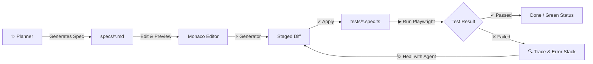

# Playwright Test Manager 🎭

Web-based control center and orchestration layer for Playwright testing augmented with intelligent Playwright Test Agents over the Agent Client Protocol (ACP).

Playwright Test Manager automates the complete test lifecycle—from planning test specifications to synthesizing test code, executing tests with real-time console streaming, embedded trace analysis, and self-healing test repairs ("Healer")—all safeguarded by a human-in-the-loop review workflow via Monaco Staged Diffs.

---

## ✨ Key Features

- 🚀 **Zero-Config CLI**: Launch in any Playwright target workspace with a single command. Opens automatically in your default browser.
- 📁 **Filesystem as Source of Truth**: Direct synchronization with `specs/*.md` (Test Specs) and `tests/*.spec.ts` (Test Scripts). Full Git compatibility without database overhead.
- ✨ **Interactive Planner**: Natural language prompt-based agent that generates structured Test Specs in Markdown with streaming output and PRD context support.
- 📝 **Split-Pane Monaco Spec Editor**: Dual-pane editor with Markdown syntax highlighting and live rendered preview.
- ⚡ **Generator with Staged Diff**: Synthesizes executable Playwright code from Test Specs with side-by-side Monaco diff inspection prior to disk writes (Apply/Reject).
- ▶️ **Playwright Test Runner**: Run individual Test Scripts or the entire test suite ("Run All") with toggles for Headed vs. Headless Mode and live WebSocket-streamed console logs.
- 🔍 **Embedded Trace Viewer**: Inspect Playwright execution traces (`trace.zip`) directly inside the application UI upon test failure.
- 🩺 **Healer Loop**: A single-click "Heal with Agent" flow feeds error stacks, traces, and source code to the Healer agent, staging targeted repairs in a diff view before re-running to verify.
- 🤖 **Built-in Mock Agent**: Deterministic, offline testing and development with zero API costs and no external credentials required.

---

## 🚀 Quick Start

### Prerequisites

- **Node.js** (v18+)
- **Playwright** installed in the target workspace

### Installation & Development

```bash
# Clone the repository and install dependencies
git clone <repo-url>
cd playwright-test-manager
npm install

# Build TypeScript
npm run build

# Run automated tests (Vitest)
npm test

# Start development server
npm run dev
```

### Running via CLI

Launch Playwright Test Manager against any target workspace directory:

```bash
# Launch in the current directory
npx tsx src/cli.ts

# Or target a specific workspace directory
npx tsx src/cli.ts /path/to/playwright-project

# Customize port and disable automatic browser opening
npx tsx src/cli.ts --port 5000 --no-open
```

### CLI Flags

| Flag | Description | Default |
| :--- | :--- | :--- |
| `[path]` | Path to target Playwright workspace root | `process.cwd()` |
| `--port <number>` | HTTP port for the web interface | `4321` |
| `--host <string>` | Host address to bind to | `localhost` |
| `--no-open` | Prevent automatic opening of default browser | `false` |

---

## 📂 Directory Structure & Conventions

Playwright Test Manager operates directly on standard filesystem conventions within your target workspace:

```text
workspace/
├── specs/                   # Markdown Test Specs with YAML frontmatter
│   ├── auth-login.md
│   └── checkout-flow.md
├── tests/                   # Executable Playwright test scripts
│   ├── auth-login.spec.ts
│   └── checkout-flow.spec.ts
└── test-results/            # Execution artifacts and Playwright trace.zip
    └── checkout-flow/
        └── trace.zip
```

---

## 🔄 Workflow & Architecture



1. **Plan**: Provide natural language goals or requirements. The Planner streams a structured Markdown spec with objectives, steps, and assertions.
2. **Refine**: Edit specs in the split-screen Monaco editor with immediate live rendering.
3. **Generate & Review**: The Generator synthesizes Playwright test code held in an isolated in-memory Staged Diff. Review differences and click **Apply** to commit to disk.
4. **Execute**: Run individual tests or the full suite in Headed or Headless mode while watching real-time console streaming.
5. **Diagnose & Heal**: On failure, error stacks and an embedded Trace Viewer open immediately. Click **Heal with Agent** to generate a targeted fix presented in a Staged Diff before verifying the fix.

---

## 🧪 Testing & Quality Assurance

Developed test-first using strict Test-Driven Development (TDD) across pre-agreed seams:

```bash
# Run all unit and integration tests
npm test

# Run tests in watch mode
npm run test:watch
```

The test suite covers:
- **Runner Engine**: Child process execution, stdout/stderr capture, `--headed` flag handling, and failure artifact discovery (`trace.zip`).
- **Mock Agent**: Deterministic streaming and cancellation for Planner, Generator, and Healer agents.
- **Fastify & WebSocket API**: REST endpoints, Server-Sent Events (SSE), and live WebSocket run status broadcasting.
- **UI & Staging Lifecycle**: Monaco editor integration, staged diff isolation, and end-to-end failure/healing/re-run cycles.

---

## 📖 Domain Vocabulary & Architectural Decisions

For full terminology definitions and architectural records, see:
- [`GLOSSARY.md`](GLOSSARY.md) – Formal definitions of Test Spec, Test Script, Planner, Generator, Healer, Staged Diff, etc.
- [`docs/adr/`](docs/adr/) – Architecture Decision Records (Filesystem as Source of Truth, ACP, Embedded Trace Viewer, Staged Diffs).

---

## 📄 License

[MIT](LICENSE)
