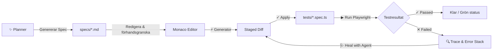

# Playwright Test Manager 🎭

Webbaserat kontrollcenter och orkestreringslager för Playwright-tester, förstärkt med intelligenta Playwright Test Agents över Agent Client Protocol (ACP).

Playwright Test Manager automatiserar hela testlivscykeln – från planering av testspecifikationer till kodgenerering, testkörning med konsolströmning i realtid, inbäddad trace-analys och självreparerande tester ("Healer") – allt med en mänsklig säkerhetsspärr (Human-in-the-Loop) via Monaco Staged Diff.

---

## ✨ Huvudfunktioner

- 🚀 **Noll-konfigurations CLI**: Starta i vilken Playwright-arbetsyta som helst med ett enda kommando. Webbläsaren öppnas automatiskt.
- 📁 **Filsystemet som sanningskälla**: Direkt synkronisering mot `specs/*.md` (Test Specs) och `tests/*.spec.ts` (Test Scripts). Full Git-kompatibilitet utan databasberoende.
- ✨ **Interaktiv Planner**: Promptbaserad agent som genererar strukturerade Test Specs i Markdown med stöd för PRD-kontext och realtidsströmning.
- 📝 **Split-pane Monaco Spec Editor**: Tvådelad editor med Markdown-syntaxmarkering och live-renderad förhandsgranskning.
- ⚡ **Generator med Staged Diff**: Omvandlar Test Specs till körbara Playwright-skript med visuell "side-by-side" granskning före filskrivning (Apply/Reject).
- ▶️ **Playwright Test Runner**: Kör enskilda testskript eller hela sviten ("Run All") med valbart körläge (Headed/Headless Mode) och WebSocket-strömmad konsolutdata.
- 🔍 **Inbäddad Trace Viewer**: Granska Playwright-körningsspår (`trace.zip`) direkt i applikationens gränssnitt vid testfel.
- 🩺 **Healer Loop**: Ett klick på "Heal with Agent" skickar felstack, spår och källkod till Healer-agenten, som syntetiserar en riktad lagning och visar diffen för godkännande innan testet verifieras på nytt.
- 🤖 **Inbyggd Mock Agent**: Full funktionalitet för utveckling, demonstration och automatiska tester offline utan externa API-nycklar.

---

## 🚀 Snabbstart

### Förutsättningar

- **Node.js** (v18+)
- **Playwright** i målarbetsytan

### Installation & Utveckling

```bash
# Klona repot och installera beroenden
git clone <repo-url>
cd playwright-test-manager
npm install

# Bygg TypeScript
npm run build

# Kör testerna (Vitest)
npm test

# Starta utvecklingsserver
npm run dev
```

### Kör via CLI

Starta Playwright Test Manager mot en valfri arbetskatalog:

```bash
# Starta i aktuell mapp
npx tsx src/cli.ts

# Eller mot en specifik arbetskatalog
npx tsx src/cli.ts /sökväg/till/ditt-playwright-projekt

# Anpassa port och stäng av automatisk webbläsaröppning
npx tsx src/cli.ts --port 5000 --no-open
```

### CLI-flaggor

| Flagga | Beskrivning | Standard |
| :--- | :--- | :--- |
| `[path]` | Sökväg till Playwright-arbetsytan | `process.cwd()` |
| `--port <nummer>` | HTTP-port för kontrollcentret | `4321` |
| `--host <adress>` | Nätverksvärd | `localhost` |
| `--no-open` | Öppna inte standardwebbläsaren automatiskt vid start | `false` |

---

## 📂 Katalogstruktur & Konventioner

Playwright Test Manager förväntar sig och organiserar filer enligt följande struktur i målarbetsytan:

```text
arbetsyta/
├── specs/                   # Test Specs i Markdown med frontmatter
│   ├── auth-login.md
│   └── checkout-flow.md
├── tests/                   # Körbara Playwright-testskript
│   ├── auth-login.spec.ts
│   └── checkout-flow.spec.ts
└── test-results/            # Körningsartefakter och Playwright trace.zip
    └── checkout-flow/
        └── trace.zip
```

---

## 🔄 Arbetsflöde & Arkitektur



1. **Planera**: Ange krav eller användarscenarier. Plannern strömmar en strukturerad Markdown-specifikation med mål, teststeg och assertioner.
2. **Redigera**: Justera specifikationen i den tvådelade editorn med omedelbar rendering.
3. **Generera & Granska**: Generatorn skapar Playwright-kod som placeras i en isolerad in-memory diff. Granska skillnaderna och klicka på **Apply** för att spara till disk.
4. **Kör**: Exekvera enskilda tester eller hela sviten. Se teststeg och konsolutdata strömmas i realtid.
5. **Felsök & Reparera**: Vid fel visas felstacken och en inbäddad Trace Viewer öppnas. Klicka på **Heal with Agent** för att generera en automatisk reparation som ställs upp i en ny Staged Diff.

---

## 🧪 Testning & Kvalitetssäkring

Projektet utvecklas strikt med testdriven utveckling (TDD) över väldefinierade sömmar (seams):

```bash
# Kör hela testsviten (unit- och integrationstester)
npm test

# Kör i bevakningsläge
npm run test:watch
```

Testsviten täcker:
- **Runner Engine**: Processhantering, stdout/stderr-fångst, `--headed` och felartefakter (`trace.zip`).
- **Mock Agent**: Determinisk strömning och avbrytning för Planner, Generator och Healer.
- **Fastify & WebSocket API**: REST-endpoints, Server-Sent Events (SSE) och realtidsstatus via WebSockets.
- **UI & Staging Lifecycle**: Monaco-integration, diff-stadiets isolering och fullständiga livscykeltester.

---

## 📖 Begrepp & Domänordlista

För fullständig vokabulär och arkitektoniska beslut, se:
- [`GLOSSARY.md`](file:///Users/joel/kod/app-ideas/playwright-test-manager/GLOSSARY.md) – Definitioner av Test Spec, Test Script, Planner, Generator, Healer, Staged Diff m.fl.
- `docs/adr/` – Arkitektoniska beslut (Filsystem som sanningskälla, ACP, inbäddad trace viewer, staged diffs).

---

## 📄 Licens

[MIT](LICENSE)
